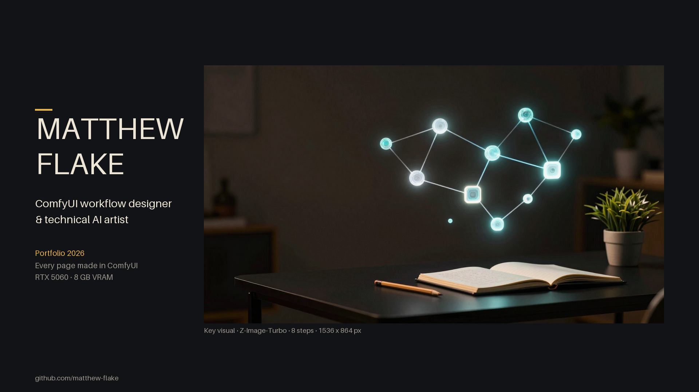
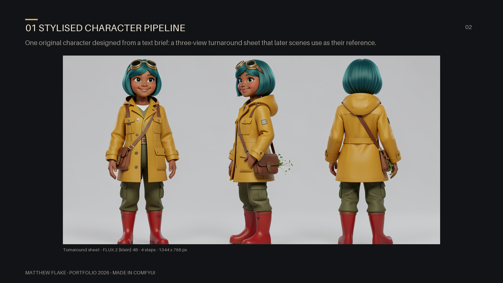
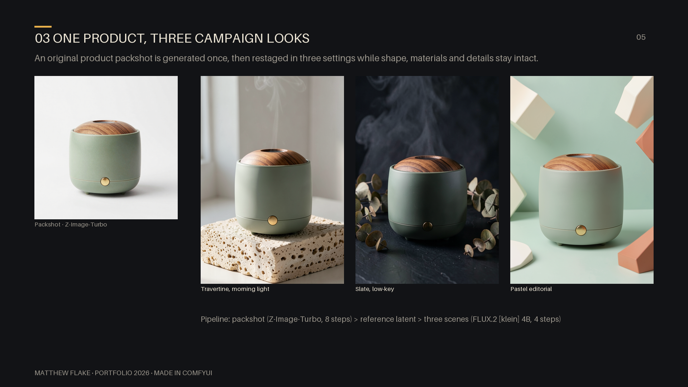
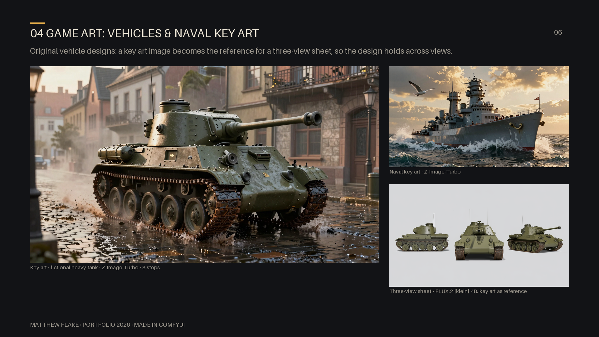
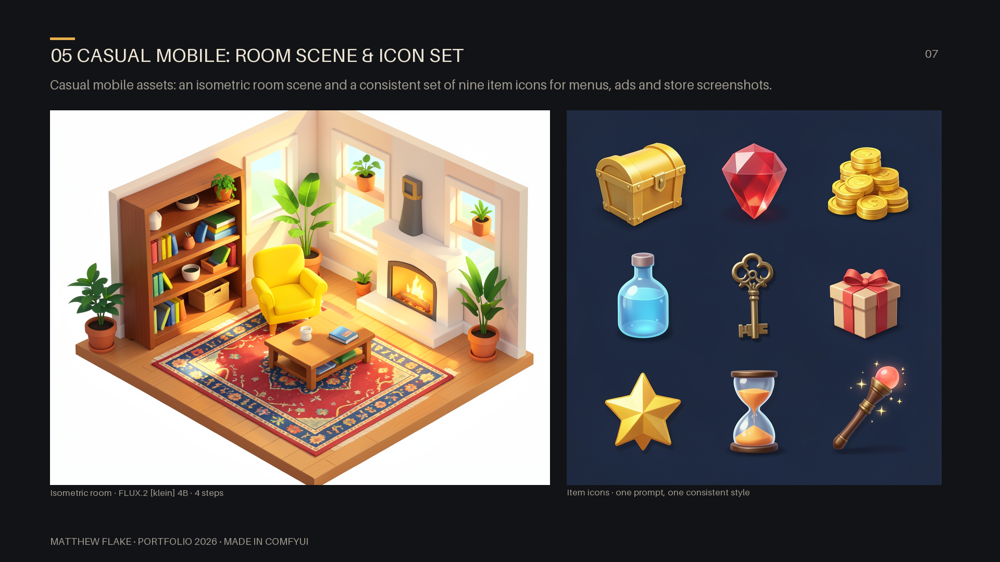
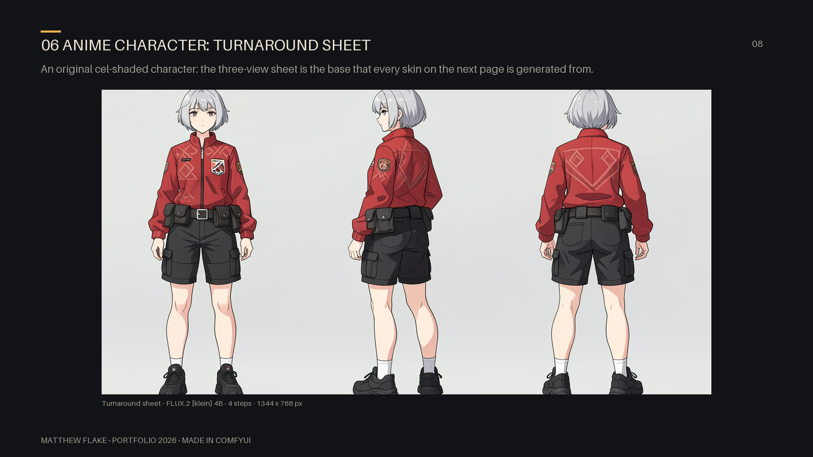
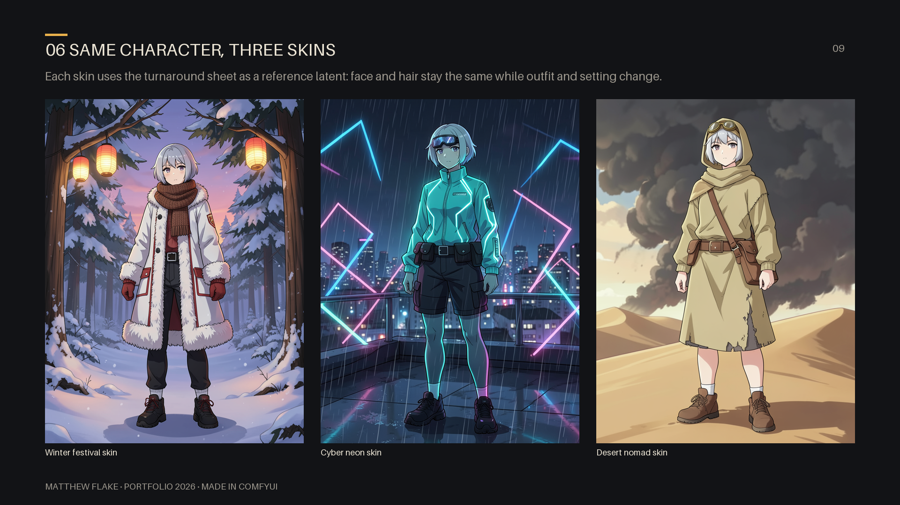
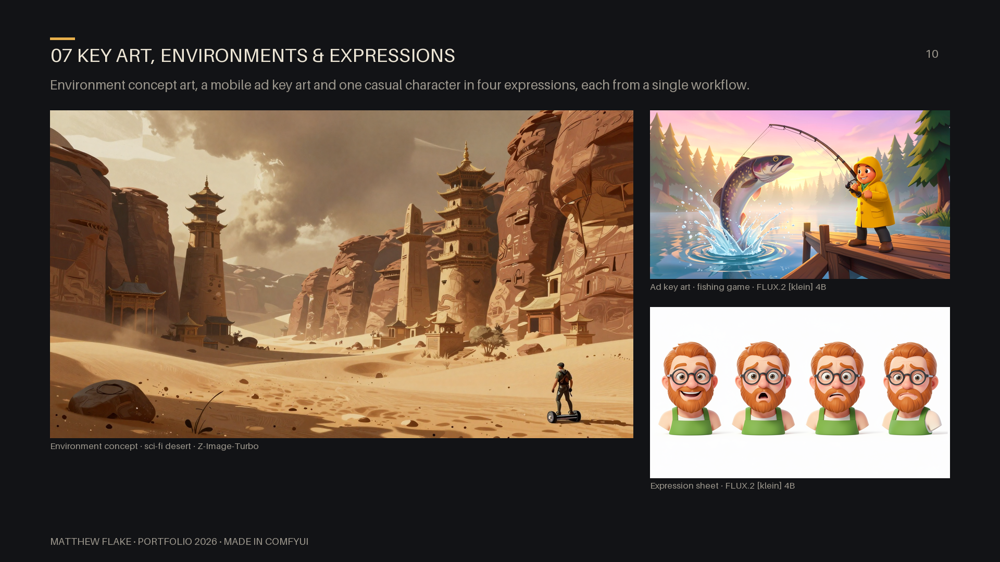
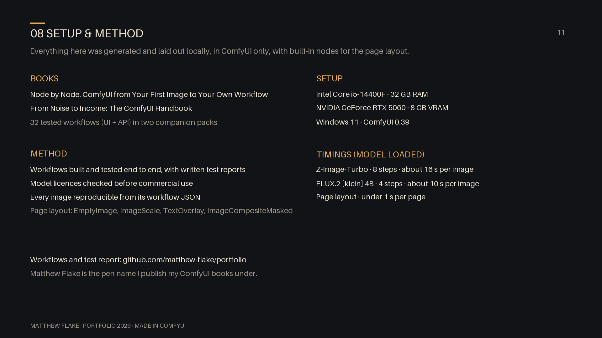

# Portfolio 2026

Selected image work by **Matthew Flake**. Every image here, and every page of the layout, was generated in **ComfyUI** on a single local machine with an 8 GB GPU. No cloud GPU and no external design tools were used. The page layout is a ComfyUI workflow too, built only from core nodes.

📄 **[Download the PDF](matthew-flake-portfolio-2026.pdf)** (11 pages, 1920 × 1080)

## Projects

### 01 · Stylised character pipeline
I designed one original character from a text brief and generated a three-view turnaround sheet. Each later scene uses that sheet as a reference latent, so the face, outfit and proportions stay consistent.

### 02 · Sketch to render: single-family house
A concept sketch is used as the reference for a photoreal day render and a blue-hour variant. The massing, roof pitch and facade carry over from the sketch.

### 03 · One product, three campaign looks
An original product (a ceramic aroma diffuser) is generated once as a packshot and then restaged in three settings. Its shape, materials and details are kept.

### 04 · Game art: vehicles and naval key art
Original vehicle designs with no insignia. A cinematic key art image is used as the reference for a three-view sheet, so the design stays the same across views.

### 05 · Casual mobile: room scene and icon set
An isometric room in a casual mobile style and a set of nine item icons generated in one consistent look.

### 06 · Anime character with three skins
An original cel-shaded character turnaround, then three skins generated from it as a reference latent. Face and hair stay the same, while the outfit and setting change.

### 07 · Key art, environments and expressions
A sci-fi desert environment concept, a key art image for a mobile fishing game and one casual character in four expressions.

### 08 · Setup & method

## What's in this repo

| Folder | Contents |
|---|---|
| [`images/`](images) | The 24 source images, full resolution. Each PNG carries its own workflow, so you can drag it into ComfyUI. |
| [`workflows/images/`](workflows/images) | One API-format workflow per image (prompt, seed, sampler settings) |
| [`workflows/pages/`](workflows/pages) | The page-layout workflows (EmptyImage, LoadImage, ImageScale, TextOverlay, ImageCompositeMasked) |
| [`pages/`](pages) | The eleven finished pages |
| [`TESTED.md`](TESTED.md) | Hardware, software and measured timings |
| [`MODELS.md`](MODELS.md) | Model files, where to get them, licences |

## Reproducing

1. Download the models listed in [MODELS.md](MODELS.md) into the usual ComfyUI model folders.
2. Workflows that load an image (reference scenes and page layouts) expect the files from `images/` in `ComfyUI/input/`. Copy them there first.
3. Load a JSON from `workflows/` with *Workflow → Open*, or drag the matching PNG onto the canvas, then queue it.

Seeds are fixed, but results can still differ slightly between GPUs, drivers and ComfyUI versions.

## Books

I write about ComfyUI under this pen name. The companion workflow packs are public:

- [**node-by-node**](https://github.com/matthew-flake/node-by-node): *Node by Node. ComfyUI from Your First Image to Your Own Workflow*
- [**from-noise-to-income**](https://github.com/matthew-flake/from-noise-to-income): *From Noise to Income: The ComfyUI Handbook*

## Licence

- Workflow JSON files: [MIT](LICENSE)
- Images, pages and PDF: [CC BY-NC 4.0](LICENSE-IMAGES.md)

The characters, vehicles, house and product are original designs made for this collection. None of them is based on an existing game, brand or franchise.
